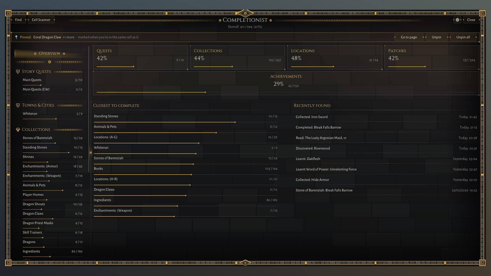

<div align="center">

# Completionist NG

**Skyrim Completion Tracker**

[](https://www.nexusmods.com/skyrimspecialedition/mods/46358) [](https://github.com/Faen668/Completionist-NG/wiki) [](LICENSE)

Track every quest, collectible, location and shout in Skyrim, its DLC and your mods, from one window in game.



</div>

---

Completionist is a native SKSE plugin built on **CommonLibSSE-NG**: no MCM, no Papyrus scripts. It watches what you do and ticks things off as they happen.

For how to use it, settings and writing patches, see the **[wiki](https://github.com/Faen668/Completionist-NG/wiki)**.

## Features

* **The Completionist window** (**Home**, or from the Journal's System tab on a controller): quests, collections, locations, shouts, kill counts and a completion log, with progress bars, find, pins and quest markers
* **Cell Scanner** (**End**): what's still to be found in the cell you're in, as a window or on screen while you play. A key can mark the nearest find with a wave that runs out over the world, and an optional shout, the Seeker's Whisper, does the same
* **Item lists**: icons and a Completionist sort in SkyUI's inventory, container, barter and gift menus
* **Crosshair tags**: "Need It!" / "Got It!" next to things you look at
* **Notifications** in their own stack, placed where you want them
* **15 themes**, including styles matching SkyUI, Dear Diary Dark Mode and Nordic UI, and one for each race of Tamriel
* Keyboard, mouse and controller support, with Xbox, PlayStation and Switch button prompts
* **Mod support** through patch files, with a [Dev Kit](devkit) for writing your own, and an API other mods can read (QuickLootIE uses it)

## Requirements

* Skyrim Special Edition or Anniversary Edition (VR isn't supported)
* SKSE64
* Address Library for SKSE Plugins

Optional: SkyUI (item list icons), Legacy of the Dragonborn (museum mode), QuickLootIE (icons in the loot window).

Install with your mod manager from [Nexus Mods](https://www.nexusmods.com/skyrimspecialedition/mods/46358).

## Building

You need Visual Studio 2022 with the C++ workload, CMake 3.21 or newer, and vcpkg with `VCPKG_ROOT` set to it.

```bash
git clone --recursive https://github.com/Faen668/Completionist-NG.git
cd Completionist-NG
cmake --preset FLATRIM
cmake --build --preset FLATRIM
```

vcpkg fetches Dear ImGui, spdlog and the other libraries on the first configure. The DLL lands in `build/FLATRIM/Release`. The release is built without VR support, so SKSE VR doesn't load it.

## Contributing

Bug reports and pull requests are welcome. With an issue, please include your Skyrim and SKSE versions, the Completionist version, `Completionist.log` (in `Documents/My Games/Skyrim Special Edition/SKSE`), any crash log and the steps to reproduce it.

## Credits

* [CommonLibSSE-NG](https://github.com/alandtse/CommonLibSSE-NG), [SKSE](https://skse.silverlock.org/) and Address Library
* [Dear ImGui](https://github.com/ocornut/imgui) by Omar Cornut
* The Dear Diary and Nordic themes are drawn in the style of [Dear Diary Dark Mode](https://www.nexusmods.com/skyrimspecialedition/mods/60837) by uranreactor and [Nordic UI](https://www.nexusmods.com/skyrimspecialedition/mods/49881) by outobugi, with our own drawing code and no files from either mod
* Fonts: Cinzel, Alegreya Sans and EB Garamond, under the SIL Open Font License 1.1

The licences of all bundled libraries are in [THIRD-PARTY-NOTICES.txt](THIRD-PARTY-NOTICES.txt).

## Licence

GPL-3.0-or-later with the Modding Exception and the GPL-3.0 Linking Exception (with Corresponding Source), following CommonLibSSE-NG. See [LICENSE](LICENSE) and [EXCEPTIONS.md](EXCEPTIONS.md).

Copyright © 2026 Faen90 / Faen668
