<div align="center">

# Completionist NG

**Skyrim Completion Tracker**

[](https://www.nexusmods.com/skyrimspecialedition/mods/46358) [](https://github.com/Faen668/Completionist-NG) [](LICENSE)

Track every quest, collectible, location and shout in Skyrim, its DLC and your mods, from one window in game.

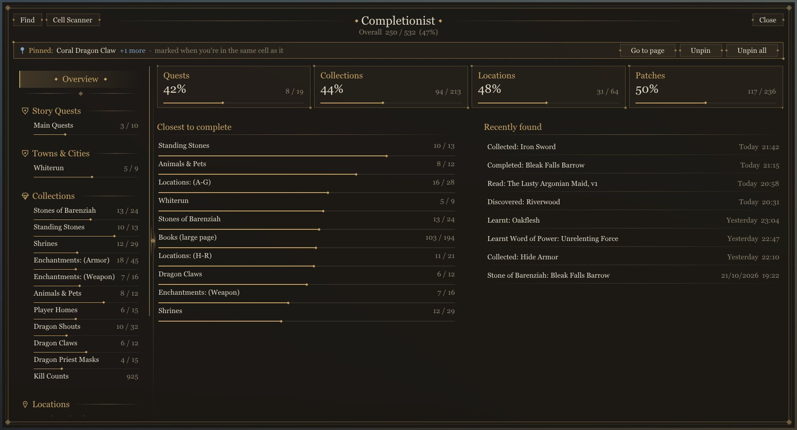

</div>

---

## What it does

Completionist watches what you do and keeps count. Pick up a unique item, read a book, learn a word of power, discover a location, finish a quest: it's ticked off as it happens, and it's all in one window you open with a key press.

The **NG** version is the native-code continuation of Completionist, built on **CommonLibSSE-NG**. Everything runs in the SKSE plugin: no MCM, no Papyrus scripts.

---

## Features

### The Completionist window

Press **Home** (or **LB + RB** on a controller) to open it. The game pauses like any other menu.

* Quests by type, town and faction, with the conditions the old MCM had (Civil War sides, Dawnguard, the Legacy museum)
* Collections, locations, shouts, kill counts and a completion log
* Progress bars everywhere, an overview of what's closest to done and what you found last
* Mark quests complete by hand, pin items, put a quest marker on a location
* Full keyboard, mouse and controller support, with Xbox, PlayStation and Switch button prompts

<table>
<tr>
<td width="50%">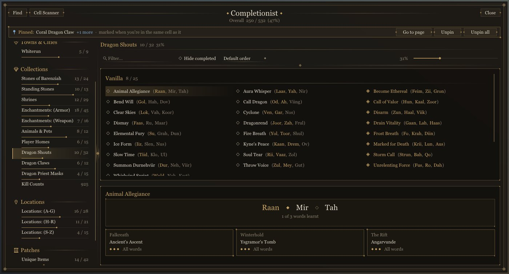<br><sub><b>Shouts:</b> every word, where it's learnt and what's left to find.</sub></td>
<td width="50%">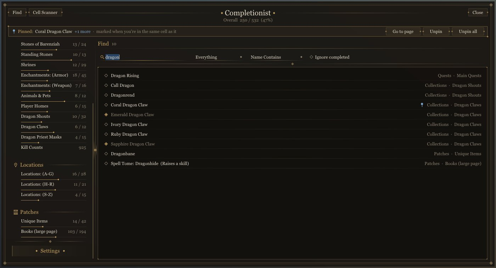<br><sub><b>Find:</b> search every page at once and jump straight to the entry.</sub></td>
</tr>
</table>

### Cell Scanner

Shows what's still to be found in the cell you're in: lying around, in containers or carried by someone. You get distance, direction and height, and a warning when taking it would be stealing. Mark anything with a quest marker, or pin an item so it glows and gets marked wherever you find it.

<table>
<tr>
<td width="62%">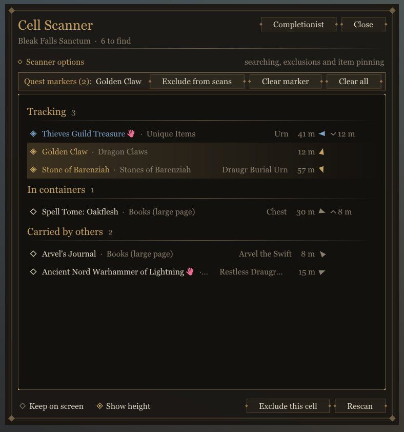</td>
<td width="38%" valign="top">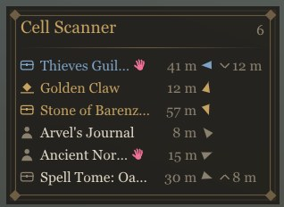<br><sub>It can also stay on screen while you play. Press <b>End</b> to open it.</sub></td>
</tr>
</table>

### Item lists

With SkyUI installed, the inventory, container, barter and gift menus get icons next to everything Completionist tracks: still needed, already found and, with Legacy of the Dragonborn, museum status. There's also a **Completionist** sort on the name column that groups items by status, with tinted bands between the groups.

Name colours and prefixes are there too if you want them, off by default. All of this works with SkyUI as it is, without replacing any of its files.

<div align="center">
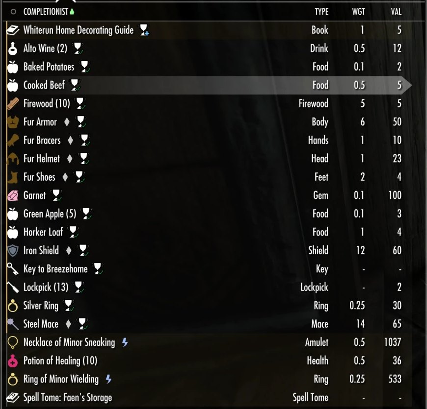
</div>

### Crosshair tags

Look at something you still need and a tag ("Need It!", "Got It!", or the museum ones) appears next to its name. The text and colours are yours to change.

### Notifications

Completionist can show its notifications in its own stack instead of the top-left corner: grouped bursts, a position you pick by dragging, and room for more than one at a time.

### Settings

Everything is set from the window itself and saved to `Completionist.ini`, so it's the same in every save.

<div align="center">
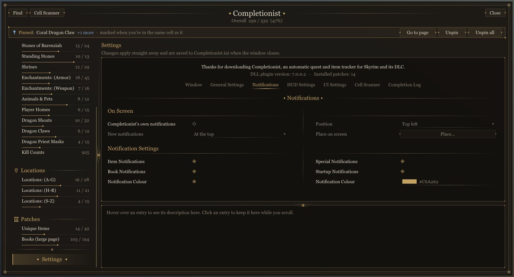
</div>

---

## Themes

Six looks to choose from in **Settings > Window > Theme**.

<table>
<tr>
<td align="center" width="33%">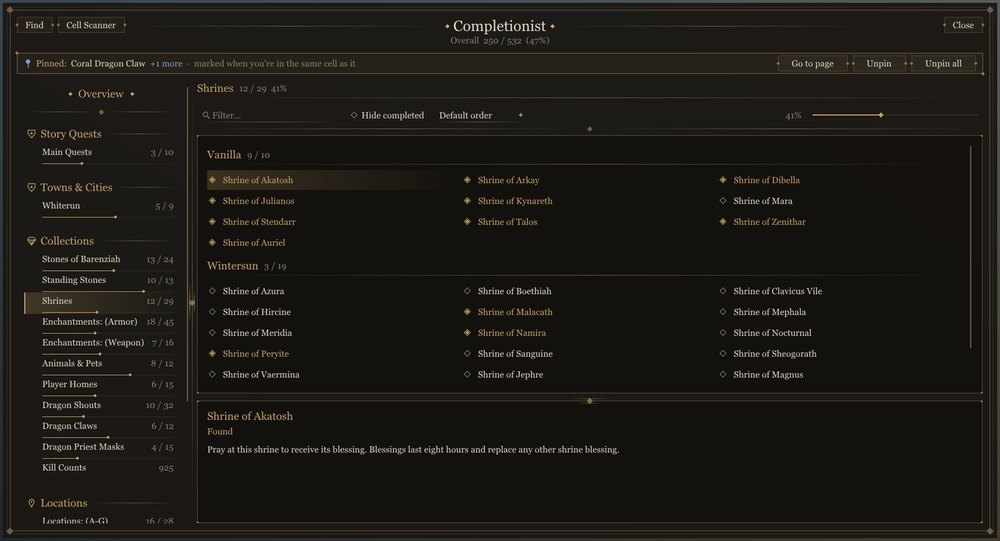<br><b>Completionist</b></td>
<td align="center" width="33%">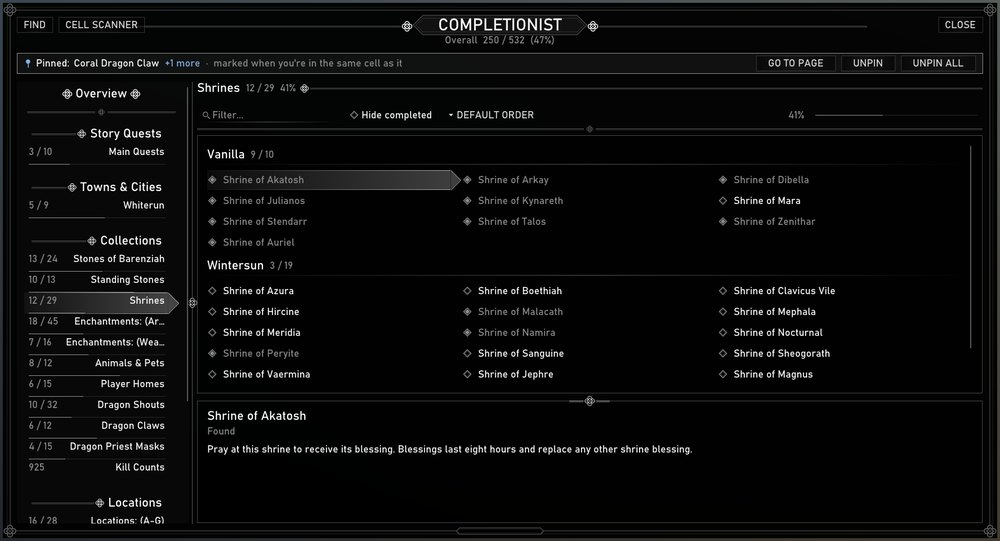<br><b>SkyUI</b></td>
<td align="center" width="33%">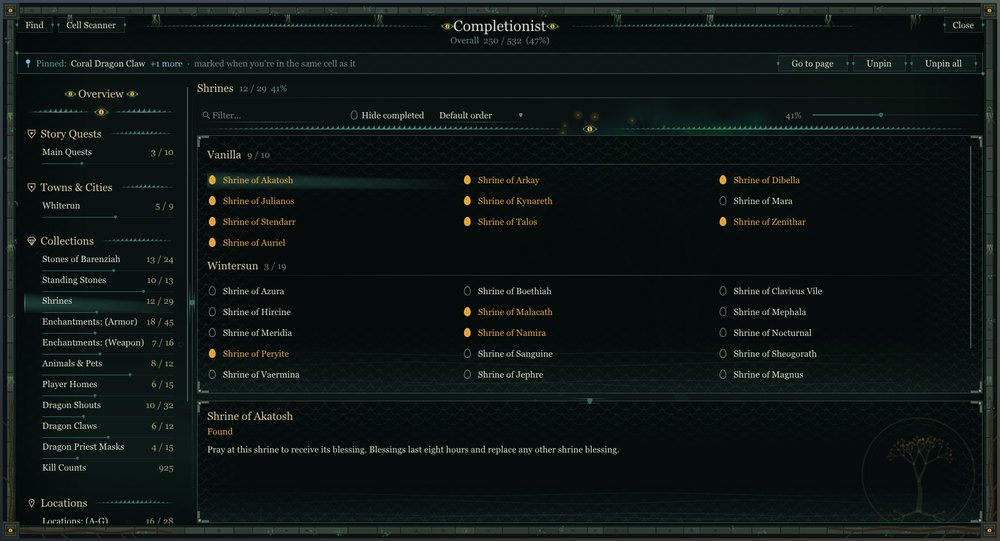<br><b>Argonian</b></td>
</tr>
<tr>
<td align="center">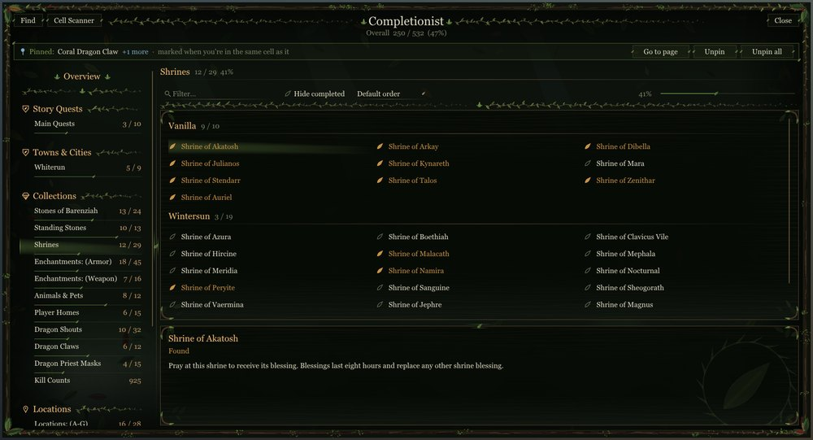<br><b>Bosmer</b></td>
<td align="center">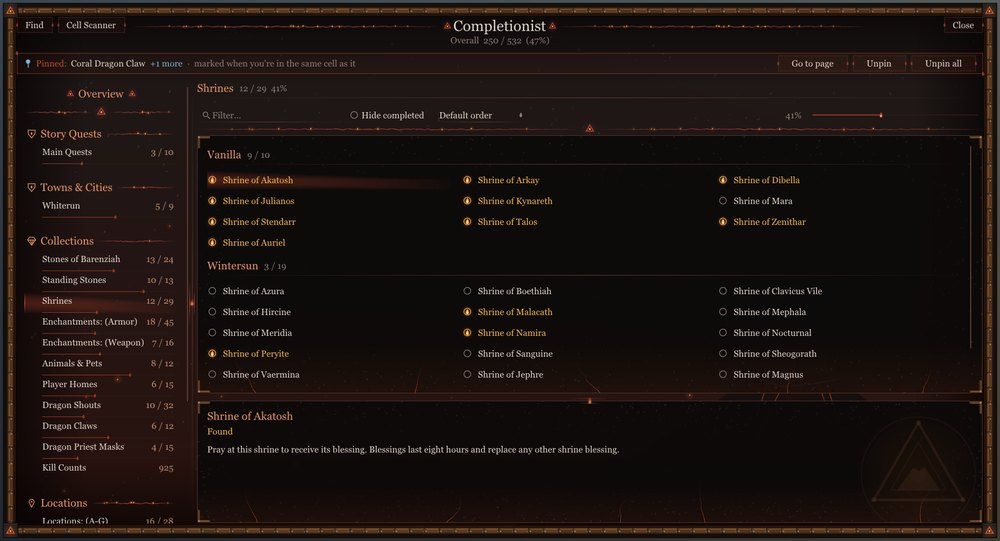<br><b>Dunmer</b></td>
<td align="center">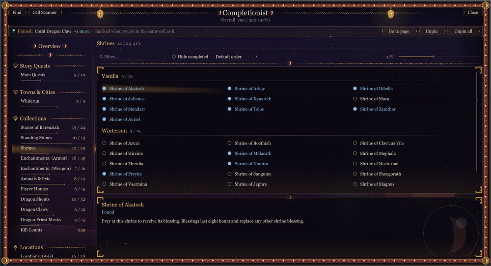<br><b>Khajiit</b></td>
</tr>
</table>

---

## Mod support

Tracking for mods comes from patch files (INI and translation files under `SKSE/Plugins/CompletionistData`). Each patch gets its own page, laid out in the sections its author chose. Patches for Legacy of the Dragonborn, spell packs, quest mods, followers and many more are available, and new ones don't need any changes to the plugin.

Other mods can read Completionist's data through its API. **QuickLootIE** uses it to show the same icons in its loot window.

---

## Requirements

* **Skyrim Special Edition / Anniversary Edition**
* **SKSE64**
* **Address Library for SKSE Plugins**

### Optional

* **SkyUI**: item icons, the Completionist sort and name colours in the item lists
* **Legacy of the Dragonborn**: museum mode
* **QuickLootIE**: Completionist icons in the loot window

See the [Nexus Mods page](https://www.nexusmods.com/skyrimspecialedition/mods/46358) for the current supported versions and installation information.

---

## Installation

Install Completionist using your preferred mod manager, along with any patches for the mods you use.

Launch the game through **SKSE64**, load a save and press **Home**.

For the latest release and installation instructions, visit:

**Nexus Mods:**
https://www.nexusmods.com/skyrimspecialedition/mods/46358

---

## Development

Completionist NG is a C++ SKSE plugin project.

The project uses:

* C++
* CommonLibSSE-NG
* Dear ImGui
* CMake
* vcpkg
* SKSE
* Address Library

Source code is available on GitHub:

https://github.com/Faen668/Completionist-NG

### Building

You need Visual Studio 2022 with the C++ workload, CMake 3.21 or newer, and vcpkg with `VCPKG_ROOT` set to it.

Clone the repository with its submodules (CommonLibSSE-NG and DKUtil live in `extern`):

```bash
git clone --recursive https://github.com/Faen668/Completionist-NG.git
cd Completionist-NG
```

Configure and build:

```bash
cmake --preset ALL
cmake --build --preset ALL
```

vcpkg fetches Dear ImGui, spdlog and the other libraries on the first configure. The DLL lands in `build/ALL/Release`. The `FLATRIM` preset builds without VR support.

---

## Contributing

Bug reports, improvements and pull requests are welcome.

When submitting an issue, please provide as much information as possible, including:

* Skyrim runtime version
* SKSE version
* Completionist version
* Relevant mod list
* `Completionist.log` (in `Documents/My Games/Skyrim Special Edition/SKSE`)
* Crash logs, if applicable
* Steps required to reproduce the issue

Pull requests should be focused and should preserve the existing project structure and coding conventions.

---

## Credits

Completionist would not be possible without the work of the Skyrim modding community.

### CommonLibSSE-NG

Completionist NG uses **CommonLibSSE-NG** as its native Skyrim development framework.

https://github.com/alandtse/CommonLibSSE-NG

### SKSE

The Skyrim Script Extender provides the runtime extension framework used by Completionist.

https://skse.silverlock.org/

### Address Library

Address Library provides runtime-independent addresses used by native Skyrim plugins.

### SkyUI

Completionist's item icons and sort work inside SkyUI's item lists.

### Dear ImGui

The in-game Completionist window is drawn with **Dear ImGui** by Omar Cornut (MIT licence).

https://github.com/ocornut/imgui

### Fonts

The in-game window ships these fonts, each under the **SIL Open Font License 1.1** (licence files are included next to the fonts in `SKSE/Plugins/CompletionistData/Fonts`):

- **Cinzel**: Natanael Gama, The Cinzel Project Authors (https://github.com/NDISCOVER/Cinzel)
- **Alegreya Sans**: Juan Pablo del Peral, HT Fonts, The Alegreya Sans Project Authors (https://github.com/huertatipografica/Alegreya-Sans)
- **EB Garamond**: Georg Duffner, Octavio Pardo, The EB Garamond Project Authors (https://github.com/octaviopardo/EBGaramond12)

---

## Licence

Completionist NG is released under the:

**GNU General Public License v3.0 or later (GPL-3.0-or-later)**

with the **Modding Exception** and **GPL-3.0 Linking Exception (with Corresponding Source)**.

See [`LICENSE`](LICENSE) and [`EXCEPTIONS.md`](EXCEPTIONS.md) for the complete licence terms.

This licensing arrangement follows the licensing model used by CommonLibSSE-NG.

In particular, the Modding Exception permits the software to be linked with the proprietary code it is intended to modify, including Skyrim, while retaining the GPL requirements for the applicable open-source code.

---

## Distribution & Mod Permissions

The source code of Completionist NG is licensed according to the terms described above.

The licence applies to the **source code of the project**. It does not automatically grant permission to redistribute Bethesda's game assets, third-party assets, or other copyrighted material included or referenced by the project.

Third-party assets remain subject to their respective licences and permissions.

For the latest user-facing distribution permissions, please also refer to the Permissions and Credits section of the [Nexus Mods page](https://www.nexusmods.com/skyrimspecialedition/mods/46358).

---

## Disclaimer

Completionist NG is provided **"AS IS"**, without warranty of any kind, express or implied.

The authors and contributors are not responsible for loss of save data, corrupted saves, crashes, incompatibilities, or other damage resulting from the use of this software.

Always maintain appropriate backups of your Skyrim installation and save files.

---

## Project Links

* **Nexus Mods:** https://www.nexusmods.com/skyrimspecialedition/mods/46358
* **GitHub:** https://github.com/Faen668/Completionist-NG
* **CommonLibSSE-NG:** https://github.com/alandtse/CommonLibSSE-NG
* **SKSE:** https://skse.silverlock.org/

---

**Completionist NG**
Copyright © 2026 Faen90 / Faen668

Licensed under the GNU General Public License v3.0 or later, with the applicable modding and linking exceptions.
